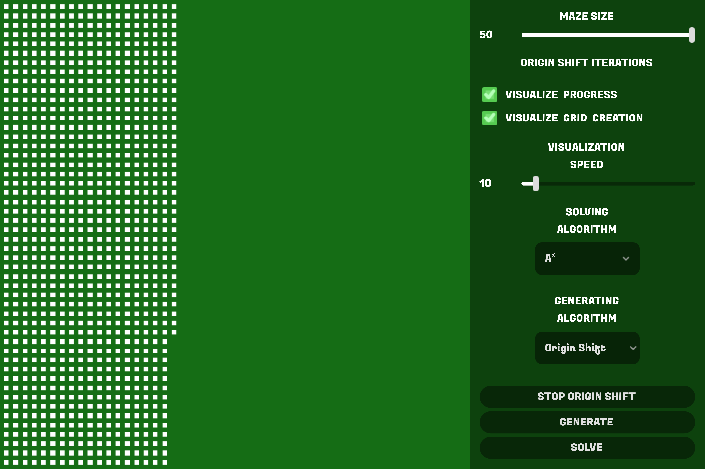
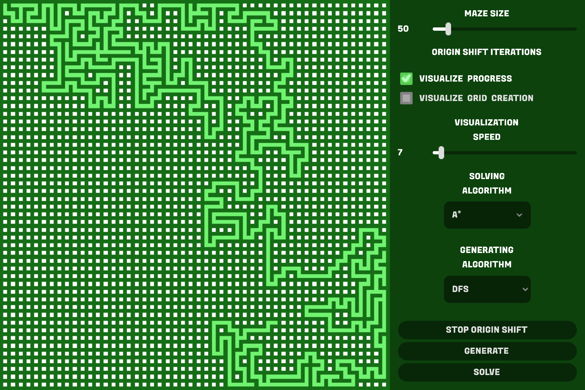
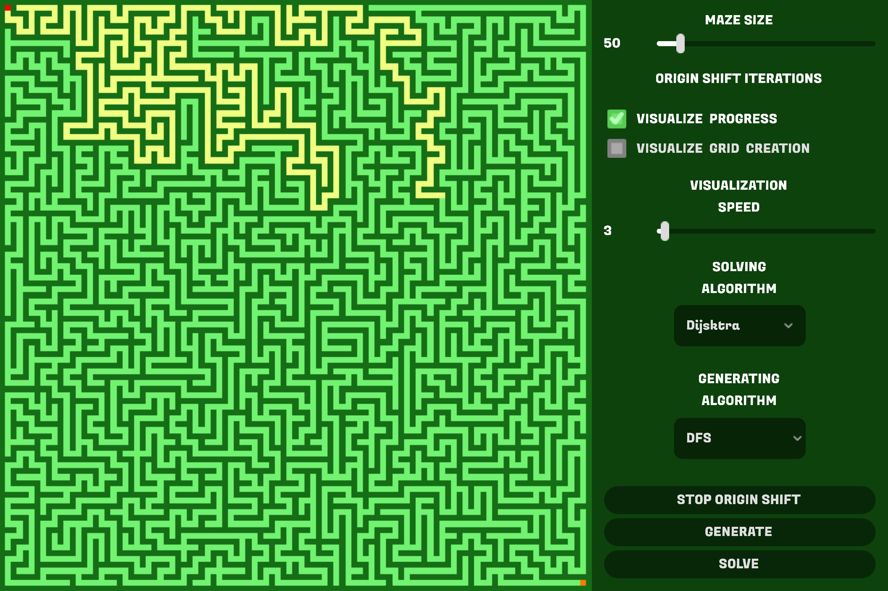
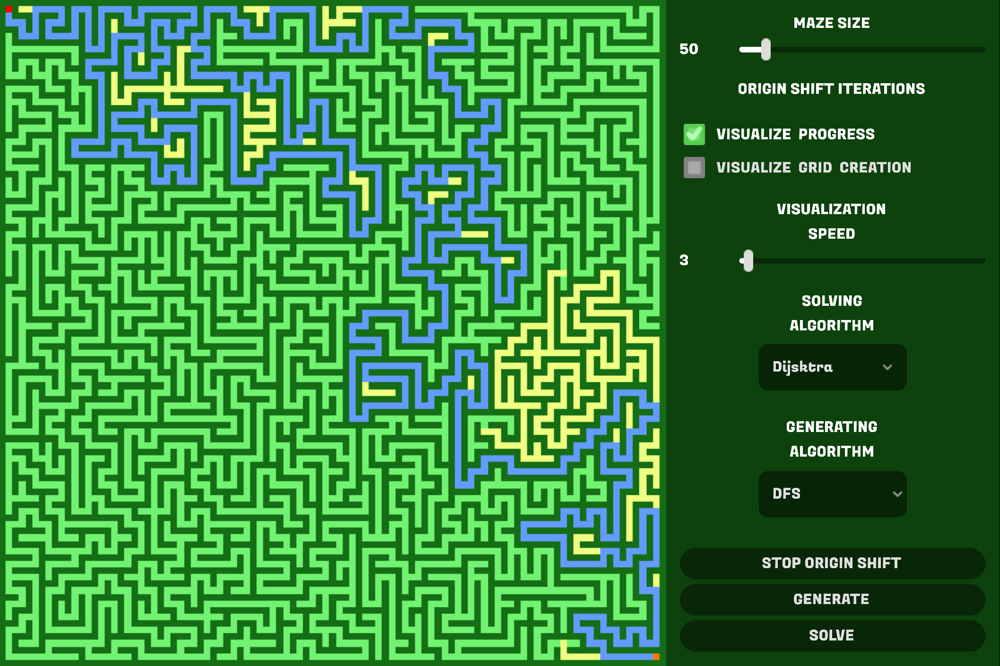

# **MAZE GENERATOR-SOLVER**
#### GitHub repo: https://github.com/ADOGamedev/Maze_Generator-Solver

#### Description: This is an application made in Godot 4.5. It's a maze generator and also a maze solver, there are 3 different algorithms for each.

## Controls

- **Ctrl + Mouse Wheel**: to zoom in and out of the maze.

- **Left Click**: while zoomed, you can move the camera around with left click.

## Usage

At the left there is a panel with some controllers, we'll go through them one by one:

- **Maze Size**: an slider which allows yo to change the size of the maze. The maximun size varies depending on the generating algorithm, this is for safety.
The max sizes for the different algorithms are these:
    - **DFS**: 500
    - **HAK**: 50
    - **Origin Shift**: 50

- **Visualize Progress**: when checked on, it lets you see what the generating/solving algorithm is doing.

- **Visualize Grid Creation**: kinda useless, it lets you see how each cell of the maze is created.

- **Visualization Speed**: controlls, well, how fast the visualization is shown.
> [!NOTE]
> For better controll over the slider, use the mouse wheel while on the slider to controll it more preciselly.

- **Solving Algorithm**: lets you choose one of three algorithms to solve the maze:

    - **A\***[^1]: works by exploring the maze but trying to get as close to the end.
    - **Bidirectional A\***: works like A* but the maze is explored at the same time from start to end and from end to start.
    - **Dijsktra**[^2]: works by just exploring all paths of the maze until the end is found.

- **Generating Algorithm**[^3]: lets you choose one of three algorithms to generate the maze: 
    - **DFS (Depht First Search)**: works by randomly going to a new cell, if the cell is already explored it just goes back to the first alternative.
    - **HAK (Haunt-and-Kill)**: work like DFS but when it reached a dead-end, it scans the hole maze top to bottom and left to right to find the first alternative.
    - **Origin Shift**[^4]: invented by a Minecraft Redstoner! Works by staring with a default maze and being represented with a directional graph.It starts by tracking a cell that is the origin, then moves the origin and removes outcoming arrows of the graph.

- **Stop origin shift**: stops the Origin Shift algorithm because of the way it works it has to be manually stoped after some tim
> [!NOTE]
> When not visualizing the generation, Origin Shift will stop itself after some time to (almost) guarantee that you'll get a good maze.

- **Generate**: starts the generation process.

- **Solve**: starts the solving process.

## Screenshots

[^1]: https://es.wikipedia.org/wiki/Algoritmo_de_b%C3%BAsqueda_A*  
https://youtu.be/-L-WgKMFuhE?si=_yAR4hlXb86NiUkt  
https://youtu.be/qigPctCgR_k?si=IHnG4XgG4bHRP2KL

[^2]: https://es.wikipedia.org/wiki/Algoritmo_de_Dijkstra  
https://youtu.be/EFg3u_E6eHU?si=HfN03qbgabpIPNg0

[^3]: https://www.youtube.com/watch?v=uctN47p_KVk&t=631s

[^4]: https://youtu.be/zbXKcDVV4G0?si=kRm5rJU4qDdCq4rq